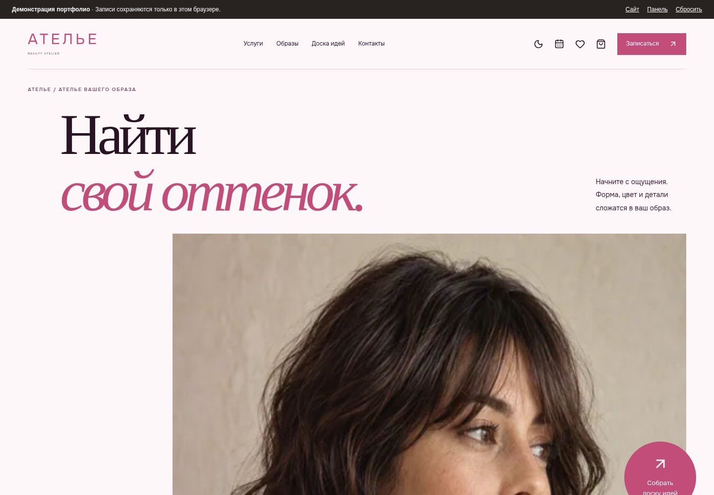
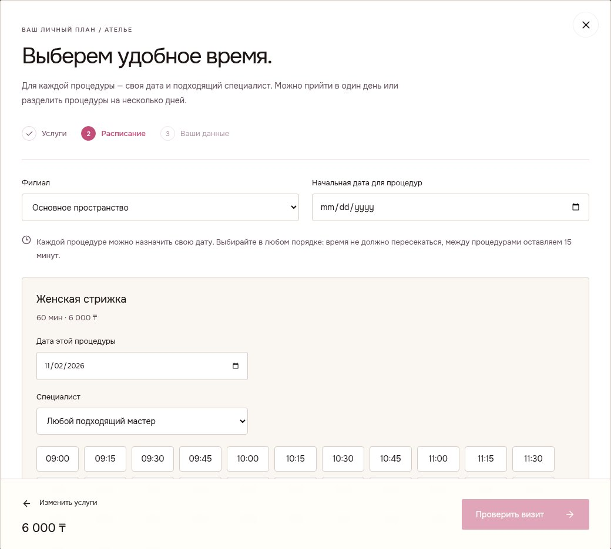
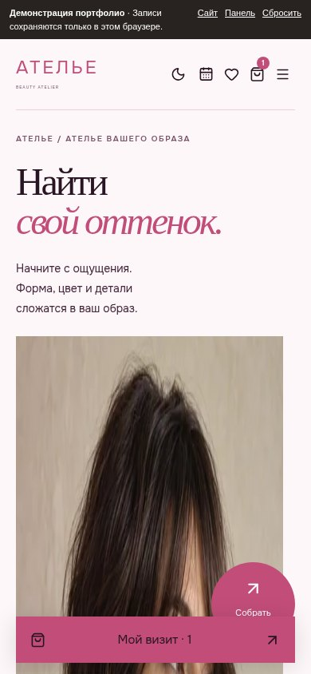
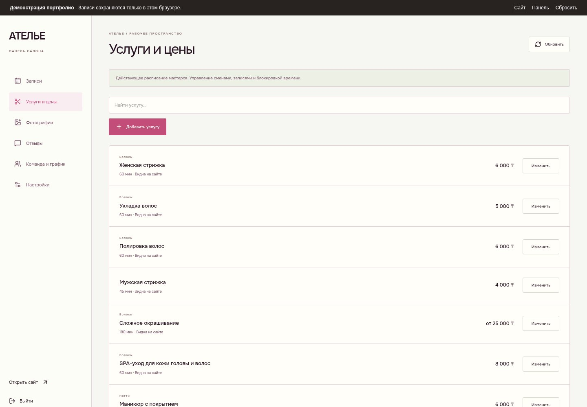

# Ателье — сайт услуг с записью

**Адаптивный сайт, который можно попробовать без сервера и установки.** Галерея образов, выбор процедур и времени визита, сохранение записи и панель администратора.

[**Скачать и открыть демо**](https://github.com/DmKOwO/atelier-booking-demo/releases/latest/download/atelier-demo.html) · [Скачать ZIP](https://github.com/DmKOwO/atelier-booking-demo/releases/latest/download/atelier-demo.zip) · [Все выпуски](https://github.com/DmKOwO/atelier-booking-demo/releases)



## Как посмотреть

1. Скачайте `atelier-demo.html` по кнопке выше. В ZIP находится тот же файл и короткая инструкция.
2. Откройте его двойным щелчком в современном браузере, например Chrome или Firefox.
3. Нажмите «Записаться», выберите услугу, свободное время и заполните демонстрационные данные.
4. Кнопка **«Панель»** в верхней полосе открывает управление записями, услугами, фотографиями и расписанием.

Фотографии, шрифты, скрипты и стили включены в один файл размером около **2,1 МБ**. Интернет, домен, регистрация, Node.js и отдельный сервер для просмотра не нужны.

## Что работает

- Светлая и тёмная темы, мобильное меню, адаптивная галерея и фильтры.
- Избранные образы и доска идей с пожеланиями к визиту.
- Выбор нескольких процедур, специалистов и времени с проверкой пересечений.
- Сохранение записей, карточка визита, файл календаря и отмена бронирования.
- Административные разделы: записи, услуги и цены, фотографии, отзывы, команда и график, настройки.
- Изменение услуг и расписания, публикация отзывов, загрузка изображений, экспорт резервной копии.

<p>
  <a href="docs/booking.jpg"></a>
  <a href="docs/mobile.jpg"></a>
</p>



## Границы демонстрации

Это портфолио-пример на основе личного веб-проекта. Название и контакты заменены демонстрационными. Фотографии — иллюстративные образы, а не подтверждённые работы действующего салона.

Данные хранятся **в этом браузере на этом устройстве**. В другом браузере будет отдельное расписание; очистка данных браузера удалит изменения. Если браузер запрещает локальное хранение, включите его или откройте файл в другом браузере. Не вводите реальные персональные данные.

Внешние сообщения и обращения по контактам отключены. Панель открывается без пароля для знакомства с интерфейсом; это не система авторизации для рабочего сайта. Для совместной работы реального салона необходим сервер. Кнопка «Сбросить» возвращает исходное демонстрационное состояние.

## Технологии

**React · TypeScript · Vite · CSS · локальное хранилище браузера**

Исходный проект использует Astro, React, сервер записи и SQLite. В этом варианте интерфейсы сохранены, а API заменён локальным адаптером с сохранением состояния. Изображения и шрифты встроены в HTML.

```text
src/components/       Интерфейсы сайта, записи и панели
src/offline.ts        Локальное API, расписание и сохранение данных
src/data/             Демонстрационный каталог
embedded-assets.json  Изображения для автономного файла
inline.css            Стили и встроенные шрифты
build.mjs             Сборка одного HTML
```

## Сборка из исходников

```sh
npm install
npm run build
```

Результат: `atelier-demo.html`. Достаточно открыть его в браузере. Лицензии включённых библиотек и шрифта находятся в [THIRD_PARTY_NOTICES.md](THIRD_PARTY_NOTICES.md) и `licenses/`.
